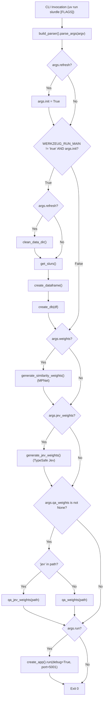

# 5.2 Command-Line Interface — Administrative Dispatcher & Operational Commands

- **Source File(s)**: [`../src/slurdletwo/cli.py`](../src/slurdletwo/cli.py)
- **CLI Entry Point**: `slurdle = "slurdletwo.cli:main"` (defined in [`../pyproject.toml`](../pyproject.toml))
- **Architectural Role**: Serves as the authoritative administrative dispatcher for Slurdle, exposing operational commands for database initialization, data scraping refreshes, offline machine learning weight generation (MPNet & TypeSafe Jev), similarity matrix QA evaluation, and local development server hosting.

## Execution Flow (`cli`)

1. **Argument Parsing**: `main()` passes command-line arguments to `build_parser()`, generating an `argparse.Namespace`.
2. **Refresh Cascade**: If `--refresh` is supplied, `args.init` is automatically enabled.
3. **Reloader Guard & ETL Execution**: To prevent Werkzeug's auto-reloader process from performing duplicate database builds, `os.environ.get("WERKZEUG_RUN_MAIN") != "true"` guards the initialization phase. If valid, stale data files are unlinked (when refreshing), HTML is scraped or read from cache, transformed into a normalized DataFrame, and written to SQLite.
4. **MPNet Embeddings Generation**: When `--weights` is flagged, the SentenceTransformers MPNet pipeline computes an offline dense cosine similarity matrix.
5. **TypeSafe Jev Pipeline**: When `--jev-weights` is flagged, the TypeSafe AI System One pipeline computes calibrated pairwise probabilities via OpenRouter.
6. **Quality Assurance Matrix Evaluation**: When `--qa-weights` is specified, the CLI inspects the target file path and routes to the appropriate QA evaluation function (`qa_jev_weights` or `qa_weights`), outputting top, middle, and bottom pairs along with corridor distributions.
7. **Development Server Execution**: When `--run` is flagged, `create_app()` initializes the application factory and launches Flask on port 5001.

## Data Models, Constants, & State

| Symbol | Type / Value | Architectural Purpose |
| :----- | :----------- | :-------------------- |
| `parser` | `argparse.ArgumentParser` | Configured CLI command definition parser. |
| `argv` | `list[str] | None` | Optional parameter list allowing programmatic dispatch in integration tests. |

## Symbol & Function Inventory

| Symbol | Signature & Return Type | Detailed Behavior & Side Effects |
| :----- | :---------------------- | :------------------------------- |
| `build_parser` | `() -> argparse.ArgumentParser` | Constructs and configures the CLI argument parser with flags for administrative actions. |
| `main` | `(argv: list[str] | None = None) -> int` | Primary CLI entry point resolving flags, orchestrating ETL/ML/Server execution, and returning status codes. |

## CLI Flag & Option Mapping Matrix

| CLI Argument / Flag | `argparse` Config | Downstream Library / Subsystem Mapping |
| :------------------ | :---------------- | :------------------------------------- |
| `--init` | `action="store_true"` | Triggers ETL data build: `get_slurs()`, `create_dataframe()`, `create_db()`. |
| `--refresh` | `action="store_true"` | Unlinks existing `slurs.html`, `slurs.csv`, and `slurs.db`, then triggers `--init`. |
| `--run` | `action="store_true"` | Calls `create_app().run(debug=True, port=5001)` to start the local WSGI server. |
| `--weights` | `action="store_true"` | Invokes `slurdletwo.ml.mpnet.generate_similarity_weights()` for MPNet encoding. |
| `--jev-weights` | `action="store_true"` | Invokes `slurdletwo.ml.jev.generate_jev_weights()` using TypeSafe Jev via OpenRouter. |
| `--qa-weights [PATH]` | `nargs="?", const=""` | Invokes QA evaluation suite against specified CSV matrix or default weights file. |

## Internal Mechanics, Error Handling, & Signal Contract

- **Reloader Isolation Invariant**: The check `os.environ.get("WERKZEUG_RUN_MAIN") != "true"` prevents catastrophic data races when `slurdle --init --run` is executed with debug mode, ensuring only the parent process executes disk write ETL operations.
- **Dynamic Module Import**: Large machine learning dependencies (`sentence-transformers`, `torch`, `typesafe-sdk`) are imported lazily inside flag-handling conditionals (`if args.weights:`, `if args.jev_weights:`). This ensures basic CLI commands (such as `--help` or `--run`) load in under 100 milliseconds without incurring heavyweight ML import overhead.
- **Stream & Exit-Code Contract**:
  - `stdout`: Emits human-readable QA ranking tables, embedding generation progress bars, and operational notices.
  - `stderr`: Emits critical error traces and invalid argument notifications.
  - Exit Codes: `0` on successful execution; `1` on unhandled execution error or invalid CLI arguments.
