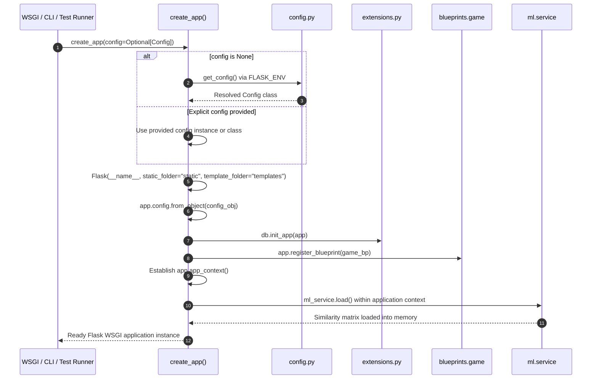

# 5.1 Application Factory & Configuration — Factory Pattern, Extensions, & Environment Isolation

- **Source File(s)**: [`../src/slurdletwo/__init__.py`](../src/slurdletwo/__init__.py), [`../src/slurdletwo/config.py`](../src/slurdletwo/config.py), [`../src/slurdletwo/extensions.py`](../src/slurdletwo/extensions.py)
- **Architectural Role**: Initializes the Flask WSGI instance dynamically via `create_app()`, binds decoupled extensions (`SQLAlchemy`), registers domain blueprints, isolates environment configurations (development, testing, production), and warms up in-memory machine learning similarity matrices during process startup.

## Execution Flow (`factory`)

1. **Invocation**: The WSGI server (e.g. Gunicorn), the CLI dispatcher (`slurdle --run`), or the pytest test runner calls `create_app()`.
2. **Configuration Resolution**: If no explicit configuration is supplied, `get_config()` inspects the `FLASK_ENV` environment variable, returning `DevelopmentConfig`, `TestingConfig`, or `ProductionConfig`.
3. **Application Instantiation**: The Flask instance is created with its root package namespace, explicitly mapping `static_folder="static"` and `template_folder="templates"` within the package hierarchy.
4. **Extension Binding**: The decoupled `db = SQLAlchemy()` singleton from `extensions.py` is initialized against the active app via `db.init_app(app)`, avoiding cyclic imports.
5. **Blueprint Registration**: The gameplay blueprint `game_bp` is imported and registered with the application.
6. **In-Memory Cache Warm-Up**: An application context is created (`with app.app_context():`), prompting `ml_service.load()` to parse and memory-map precomputed CSV similarity matrices before incoming HTTP traffic arrives.
7. **Instance Return**: The fully initialized `Flask` instance is returned to the caller.

## Data Models, Constants, & State

| Symbol | Type / Value | Architectural Purpose |
| :----- | :----------- | :-------------------- |
| `PROJECT_ROOT` | `Path` (resolved relative to `config.py`) | Anchors absolute filesystem navigation to repository root. |
| `DATA_DIR` | `PROJECT_ROOT / "data"` | Path to persistent storage containing databases and similarity matrices. |
| `SLURS_DB` | `DATA_DIR / "slurs.db"` | Path to the active SQLite relational database file. |
| `MIN_SEMANTIC_SIMILARITY` | `0.30` | Lower bound of viable semantic corridor for trivia distractors. |
| `MAX_SEMANTIC_SIMILARITY` | `0.80` | Upper bound of viable semantic corridor preventing near-synonyms. |
| `Config` | Base Configuration Class | Centralizes default secret key generation, database URI, and SQLAlchemy flags. |
| `DevelopmentConfig` | Subclass of `Config` | Enables `DEBUG = True` and development server flags. |
| `TestingConfig` | Subclass of `Config` | Sets `TESTING = True`, disables CSRF/cookies, uses isolated test database. |
| `ProductionConfig` | Subclass of `Config` | Requires statically pinned `FLASK_SECRET_KEY` and enforces production constraints. |
| `db` | `SQLAlchemy` | Decoupled SQLAlchemy ORM extension singleton. |

## Symbol & Function Inventory

| Symbol | Signature & Return Type | Detailed Behavior & Side Effects |
| :----- | :---------------------- | :------------------------------- |
| `create_app` | `(config: Config | type[Config] | None = None) -> Flask` | Factory function assembling, configuring, and returning the initialized Flask web application. |
| `get_config` | `() -> type[Config]` | Inspects `FLASK_ENV` (or `ENV`) and maps to `DevelopmentConfig`, `TestingConfig`, or `ProductionConfig`. |

## Configuration Mapping Matrix

| Environment Variable | Target Configuration Key | Default Value | Internal Effect |
| :------------------- | :----------------------- | :------------ | :-------------- |
| `FLASK_ENV` | Environment Selector | `"development"` | Selects corresponding configuration class (`development`, `testing`, `production`). |
| `FLASK_SECRET_KEY` | `SECRET_KEY` | `os.urandom(24)` (ephemeral) | Cryptographic signing key for client session cookies. Must be persistent in production. |
| `DATABASE_URL` | `SQLALCHEMY_DATABASE_URI` | `"sqlite:///<DATA_DIR>/slurs.db"` | Connection URI for the SQLite relational store. |
| N/A | `SQLALCHEMY_TRACK_MODIFICATIONS` | `False` | Disables SQLAlchemy event notification system to save memory and CPU cycles. |

## Internal Mechanics, Error Handling, & Lifecycle Contract

- **Decoupled Extension Invariant**: Creating `db = SQLAlchemy()` inside `extensions.py` rather than directly in `__init__.py` or `models.py` prevents circular dependency loops when ORM models and repository helpers import `db`.
- **Pre-Fork Memory Sharing**: Under Gunicorn with `--preload`, executing `ml_service.load()` inside `create_app()` loads the similarity matrix once into parent memory, allowing OS copy-on-write page sharing across worker processes.
- **Session Key Hardening**: In development, `os.urandom(24)` is generated per application bootstrap. In production, missing `FLASK_SECRET_KEY` should be trapped to avoid invalidating sessions on worker recycles.
- **Stream & Exit-Code Contract**:
  - `stdout`: Emits initialization logs via standard Python `logging`.
  - `stderr`: Unhandled startup exceptions or missing database errors abort factory execution with nonzero exit.
