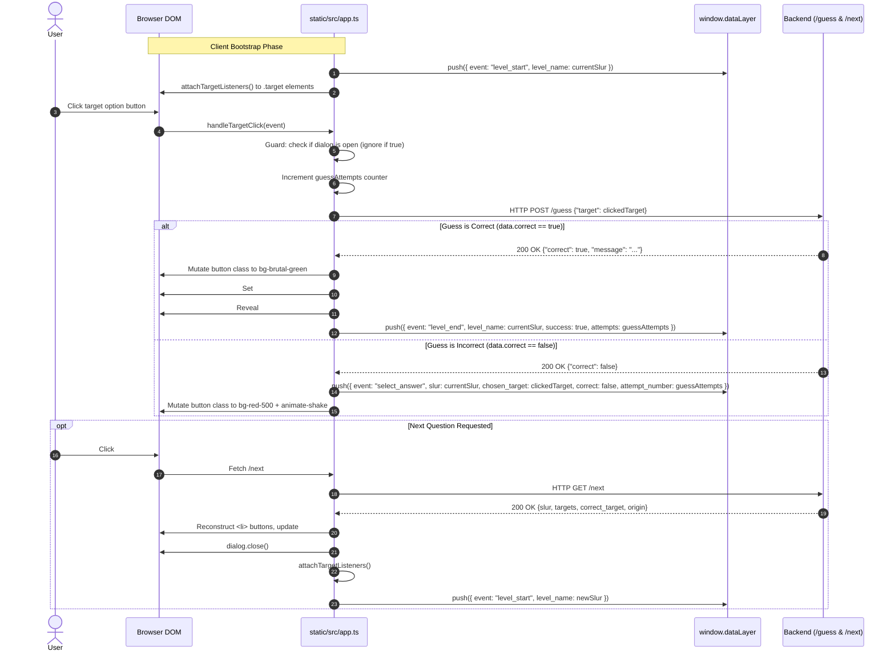

# 5.7 Frontend Presentation & Micro-SPA — Neobrutalism, TypeScript, & Telemetry

- **Source File(s)**: [`../src/slurdletwo/static/src/app.ts`](../src/slurdletwo/static/src/app.ts), [`../src/slurdletwo/static/src/input.css`](../src/slurdletwo/static/src/input.css), [`../src/slurdletwo/templates/base.jinja`](../src/slurdletwo/templates/base.jinja), [`../src/slurdletwo/templates/index.jinja`](../src/slurdletwo/templates/index.jinja)
- **Architectural Role**: Drives the client-side single-page micro-architecture. Compiled from TypeScript via `esbuild` and styled with TailwindCSS v4 Neobrutalist design tokens, this layer manages user guesses, interactive button physics, keyframe shake feedback, HTML5 `<dialog>` modal lifecycles, and Google Tag Manager (GTM) / Google Analytics 4 (GA4) telemetry.

## Execution Flow (`frontend`)

1. **Bootstrap & Initial Telemetry**: Upon script execution, `app.ts` reads the initial server-rendered slur text and immediately pushes the `level_start` event to `window.dataLayer`.
2. **Listener Attachment**: `attachTargetListeners()` binds click handlers to all `.target` buttons rendered by Jinja2.
3. **Guess Submission**: When a target option is clicked, the handler verifies the result modal is not currently open, increments the `guessAttempts` counter, and sends a `POST` request to `/guess`.
4. **Incorrect Feedback Loop**: If the answer is incorrect, the button is dynamically restyled to red (`bg-red-500`) with an `animate-shake` CSS animation, and a `select_answer` event is pushed to GA4.
5. **Success Modal & Etymology Reveal**: If correct, the button turns green (`bg-brutal-green`), the modal `<dialog id="result-dialog">` is populated with the etymology text, `dialog.showModal()` is invoked, and `level_end` telemetry is dispatched.
6. **Asynchronous Question Hydration**: Clicking "Next Question" triggers `GET /next`. The client updates the active slur heading, rebuilds the list of target buttons in the DOM, closes the modal, re-attaches click listeners, and fires a fresh `level_start` event without a full-page reload.

## Data Models, Interfaces, & State

| Symbol | Type / Scope | Architectural Purpose |
| :----- | :----------- | :-------------------- |
| `GuessResponse` | Interface (TypeScript) | Models JSON schema returned by `POST /guess` (`{correct: boolean, message?: string}`). |
| `NextQuestionResponse` | Interface (TypeScript) | Models JSON schema returned by `GET /next` (`{slur, targets, correct_target, origin}`). |
| `window.dataLayer` | Global Array | Standard GA4/GTM event bus for client-side telemetry. |
| `currentSlur` | `string` | Tracks active question identifier across client interactions. |
| `guessAttempts` | `number` | Counter tracking failed attempts before discovering the correct answer. |
| `levelEnded` | `boolean` | State guard preventing duplicate `level_end` telemetry events. |

## Symbol & Function Inventory

| Symbol | Signature & Return Type | Detailed Behavior & Side Effects |
| :----- | :---------------------- | :------------------------------- |
| `fireLevelStart` | `() -> void` | Pushes the GA4 recommended `level_start` event to `window.dataLayer`. |
| `handleTargetClick` | `(e: MouseEvent) -> void` | Submits selected target to `/guess`, validates response, applies visual styling, and sends telemetry. |
| `attachTargetListeners` | `() -> void` | Queries DOM for all `.target` elements and attaches `handleTargetClick`. |

## Design Tokens & CSS Utilities Mapping

| Design Token / Utility | CSS Definition | Aesthetic & Functional Purpose |
| :--------------------- | :------------- | :----------------------------- |
| `.shadow-brutal` | `6px 6px 0px 0px #000` | Stark, high-contrast Neobrutalist drop shadow. |
| `.shadow-brutal-sm` | `4px 4px 0px 0px #000` | Compact drop shadow for smaller UI containers. |
| `.shadow-brutal-hover` | `translate(4px, 4px) shadow(2px 2px)` | Simulates mechanical button depression on hover. |
| `.shadow-brutal-active`| `translate(6px, 6px) shadow(0px 0px)` | Simulates full button actuation on click. |
| `.animate-shake` | Keyframe translation (`-8px` to `+8px`) | Provides physical error feedback on incorrect guesses. |
| `.bg-brutal-green` | `@theme` custom token | High-visibility victory green styling. |

## Internal Mechanics, Error Handling, & Telemetry Contract

- **Accessibility & Modal Trap**: The interface utilizes the native HTML5 `<dialog>` element. Calling `dialog.showModal()` ensures focus trapping and screen reader isolation, while pressing the Escape key naturally dismisses the dialog.
- **Fail-Safe Fallback**: If an asynchronous `/next` fetch fails due to network disconnection, client logic logs the error and gracefully falls back to `window.location.href = '/'` to recover.
- **Micro-SPA Rendering Parity**: Question markup is rendered both server-side via Jinja2 (providing SEO indexability and fast initial paint) and reconstructed client-side via TypeScript DOM nodes (providing instantaneous gameplay without page refreshes).
