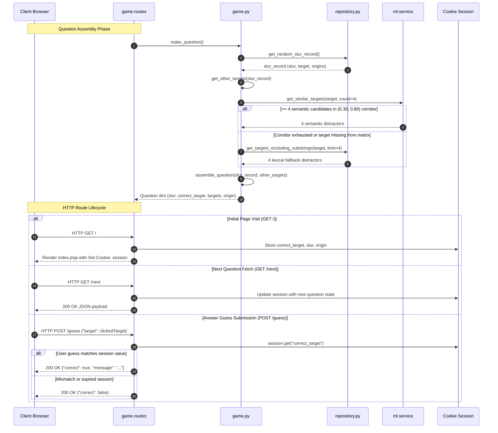

# 5.5 Game Domain Engine & Blueprint Routes — Trivia Lifecycle & Evaluation

- **Source File(s)**: [`../src/slurdletwo/game.py`](../src/slurdletwo/game.py), [`../src/slurdletwo/blueprints/game/routes.py`](../src/slurdletwo/blueprints/game/routes.py)
- **Architectural Role**: Assembles demographic trivia questions by resolving target answers against semantic or lexical distractors, encapsulates the interactive game loop, exposes HTTP endpoints via Flask blueprints, and manages server-side verification using cryptographically signed client cookies.

## Execution Flow (`game`)

1. **Question Initiation**: Either `slurdle()` (`GET /`) or `next_question()` (`GET /next`) invokes `make_question()`.
2. **True Target Extraction**: `get_random_slur_record()` queries the database and applies class-bias damping to obtain a balanced demographic record.
3. **Distractor Cascade**: `get_other_targets()` attempts semantic neighbor retrieval via `ml_service.get_similar_targets()`. If the target is missing or yields fewer than 4 candidates within the `(0.30, 0.80)` similarity corridor, it shifts to `get_targets_excluding_substrings()` for lexical filtering.
4. **Option Shuffling**: `assemble_question()` unites the true answer with the 4 distractors into a 5-element array, shuffles the list in-place using `random.shuffle()`, and packages the dictionary.
5. **Session Signing**: The route handler updates Flask's cryptographically signed session cookie with `correct_target`, `slur`, and `origin`.
6. **Defensive Evaluation**: When a guess arrives via `POST /guess`, `guess()` reads `session.get("correct_target")`. If the session has expired or is absent, it returns `{"correct": false}` without raising an unhandled `KeyError`.

## Data Models, Constants, & State

| Symbol | Type / Value | Architectural Purpose |
| :----- | :----------- | :-------------------- |
| `game_bp` | `Blueprint("game", __name__)` | Flask Blueprint encapsulating all gameplay route handlers. |
| `QuestionDict` | `dict[str, Any]` | Schema: `{"slur": str, "correct_target": str, "targets": list[str], "origin": str}`. |
| `session["correct_target"]` | `str` | Active round correct answer target stored in signed browser cookie. |
| `session["slur"]` | `str` | Active round derogatory term identifier. |
| `session["origin"]` | `str` | Etymological origin text displayed upon correct guess. |

## Symbol & Function Inventory

| Symbol | Signature & Return Type | Detailed Behavior & Side Effects |
| :----- | :---------------------- | :------------------------------- |
| `format_typographic_quotes` | `(text: str \| None) -> str` | Converts straight ASCII double quotes into proper opening (`“`) and closing (`”`) typographical quotes for Space Grotesk rendering. |
| `get_other_targets` | `(slur_record: Slur) -> list[str]` | Resolves 4 distractor targets, prioritizing ML semantic corridor over SQL lexical fallback. |
| `assemble_question` | `(slur_record: Slur, other_targets: list[str]) -> dict` | Blends correct target and distractors into a shuffled 5-option question dictionary. |
| `make_question` | `() -> dict` | Helper fetching a random record, resolving distractors, and returning an assembled question. |
| `ask_question` | `(question: dict) -> None` | Terminal-based interactive trivia loop for local CLI gameplay and debugging. |
| `debug_targets` | `() -> None` | Runs 10,000 question assembly iterations and writes `data/debug.csv` for distractor QA. |
| `slurdle` | `() -> str` | Route handler for `GET /` rendering `index.jinja` and seeding initial cookie session. |
| `next_question` | `() -> Response` | Route handler for `GET /next` returning question JSON and updating session state. |
| `guess` | `() -> Response` | Route handler for `POST /guess` validating client submission against signed session answer. |

## Route & API Payload Mapping Matrix

| Endpoint | HTTP Method | Request Body Schema | Response Status & Payload Schema | Session Mutation |
| :------- | :---------- | :------------------ | :------------------------------- | :--------------- |
| `/` | `GET` | Empty | `200 OK` (Server-Side Rendered HTML via `index.jinja`) | Seeds `correct_target`, `slur`, `origin`. |
| `/next` | `GET` | Empty | `200 OK` JSON: `{slur, targets, correct_target, origin}` | Updates `correct_target`, `slur`, `origin`. |
| `/guess` | `POST` | JSON: `{"target": string}` | `200 OK` JSON: `{"correct": true, "message": string}` or `{"correct": false}` | Read-only access via `.get()`. |

## Internal Mechanics, Error Handling, & Session Contracts

- **Defensive Session Lookup**: `session.get("correct_target")` guarantees that stale cookies, bot probes, or expired sessions return `{"correct": false}` gracefully instead of generating a 500 internal server error.
- **Corridor Exhaustion Guarantee**: Because some unique ethnic targets (e.g., obscure geographical terms) have fewer than 4 semantic neighbors in the precomputed matrix, the lexical SQL fallback is mandatory to prevent question assembly failures.
- **Tamper Resistance**: Answers stored in client cookies are protected by Flask's HMAC-SHA256 signature keyed by `FLASK_SECRET_KEY`, preventing client-side inspection or tampering.
- **Stream & Exit-Code Contract**:
  - `stdout`: Does not log directly during HTTP request handling.
  - `stderr`: Unhandled template rendering or JSON decoding errors emit HTTP 500 error logs via Werkzeug.
