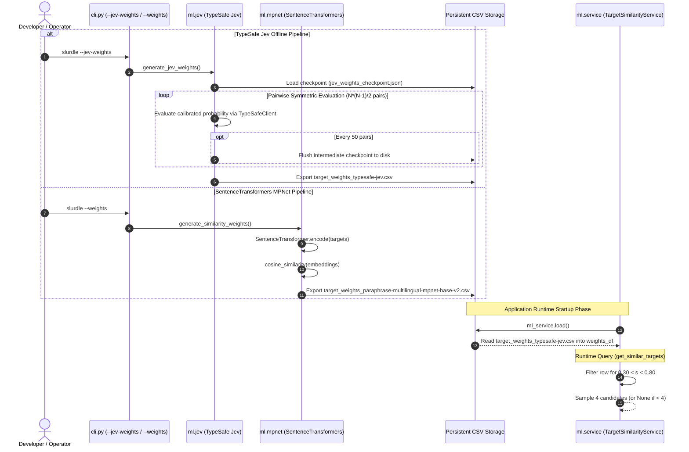

# 5.6 Machine Learning & Semantic Weight Pipeline — Dense Embeddings & Jev Decision Models

- **Source File(s)**: [`../src/slurdletwo/ml/service.py`](../src/slurdletwo/ml/service.py), [`../src/slurdletwo/ml/jev.py`](../src/slurdletwo/ml/jev.py), [`../src/slurdletwo/ml/mpnet.py`](../src/slurdletwo/ml/mpnet.py), [`../src/slurdletwo/ml/__init__.py`](../src/slurdletwo/ml/__init__.py)
- **Architectural Role**: Governs distractor generation through offline precomputation and runtime lookup. Implements two independent similarity engines: a dense vector bi-encoder (`paraphrase-multilingual-mpnet-base-v2`) and a calibrated System One decision model (TypeSafe AI Jev via OpenRouter). At runtime, `TargetSimilarityService` provides zero-latency in-memory corridor filtering.

## Execution Flow (`ml`)

1. **Jev Generation Pass**: When `--jev-weights` is executed, unique demographic targets are queried from SQLite. Checkpoint files are inspected to resume interrupted calculations. Pairwise affinities are queried via TypeSafe AI's Jev model over OpenRouter, and intermediate progress is committed to `jev_weights_checkpoint.json` every 50 iterations.
2. **MPNet Generation Pass**: When `--weights` is executed, target strings are encoded into 768-dimensional dense vectors using `sentence-transformers/paraphrase-multilingual-mpnet-base-v2`. Scikit-learn computes the pairwise cosine similarity matrix, and results are written to CSV.
3. **Runtime Ingestion**: `ml_service.load()` reads the precomputed CSV matrix into a Pandas DataFrame once during application startup. Jev weights take precedence over MPNet and legacy matrices.
4. **Corridor Filtering**: When `get_similar_targets(target, count=4)` is called during gameplay, the target row is extracted from the DataFrame. Candidate targets with similarity scores strictly between `0.30` and `0.80` are selected. If 4 or more candidates qualify, 4 are randomly sampled; otherwise `None` is returned to trigger lexical fallback.

## Data Models, Constants, & State

| Symbol | Type / Value | Architectural Purpose |
| :----- | :----------- | :-------------------- |
| `DEFAULT_JEV_WEIGHTS_FILE` | `DATA_DIR / "target_weights_typesafe-jev.csv"` | Default output CSV path for Jev-generated pairwise weights. |
| `DEFAULT_CHECKPOINT_FILE` | `DATA_DIR / "jev_weights_checkpoint.json"` | JSON state file storing intermediate evaluated pairs for safe resumption. |
| `DEFAULT_OPENROUTER_BASE_URL` | `"https://openrouter.ai/api"` | Base API endpoint for TypeSafe client dispatch. |
| `DEFAULT_JEV_MODEL` | `"typesafe/jev-1.14"` | System One decision model identifier used for demographic similarity evaluation. |
| `MIN_SEMANTIC_SIMILARITY` | `0.30` | Minimum score boundary: prevents non-matching, trivial distractors. |
| `MAX_SEMANTIC_SIMILARITY` | `0.80` | Maximum score boundary: filters near-synonyms (e.g. `"Serbs"` vs `"Serbians"`). |
| `TargetSimilarityService` | Class | Manages in-memory DataFrame storage and corridor-filtered lookup. |
| `ml_service` | Singleton Instance | Global application-level similarity service instance. |

## Symbol & Function Inventory

| Symbol | Signature & Return Type | Detailed Behavior & Side Effects |
| :----- | :---------------------- | :------------------------------- |
| `TargetSimilarityService.load` | `() -> None` | Reads precomputed similarity matrix from disk into `weights_df` memory cache. |
| `TargetSimilarityService.get_similar_targets` | `(target: str, count: int = 4) -> list[str] | None` | Retrieves `count` distractors within the configured `(0.30, 0.80)` similarity corridor. |
| `fetch_unique_demographic_targets` | `() -> list[str]` | Queries SQLite database for distinct targets sorted alphabetically. |
| `generate_jev_weights` | `() -> None` | Orchestrates TypeSafe Jev pairwise scoring, checkpointing, and CSV matrix generation. |
| `generate_similarity_weights` | `() -> None` | Encodes target embeddings using MPNet and saves cosine similarity matrix. |
| `qa_weights` | `(csv_path: str | Path | None = None) -> None` | Analyzes matrix distributions, top pairs, middle pairs, and corridor percentages. |

## CLI Flag & Option Mapping Matrix

| Flag / Option | Target Script | Required Environment Variable | Internal Behavior |
| :------------ | :------------ | :---------------------------- | :---------------- |
| `--jev-weights` | `slurdletwo.ml.jev` | `OPENROUTER_API_KEY` | Computes calibrated System One decision probabilities via OpenRouter. |
| `--weights` | `slurdletwo.ml.mpnet` | None (Local CPU/GPU) | Generates dense embeddings using SentenceTransformers. |
| `--qa-weights [PATH]` | `slurdletwo.ml.jev` / `mpnet` | None | Evaluates symmetry, corridor distribution, and candidate counts for the specified matrix. |

## Internal Mechanics, Error Handling, & Corridor Tuning

- **Corridor Calibration Rationale**: Without the upper bound (`0.80`), distractors frequently contain overlapping ethnic labels (such as `"Salvadorans"` and `"Central Americans"`), creating ambiguous questions. Without the lower bound (`0.30`), distractors are completely unrelated, making trivia trivially easy.
- **Fault-Tolerant Checkpointing**: Because computing an $N \times N$ matrix for 138 targets requires evaluating 9,453 distinct pairs, network hiccups or rate limits would otherwise waste API credits. The Jev pipeline writes to `jev_weights_checkpoint.json` every 50 pairs, allowing immediate resumption from the exact point of failure.
- **Memory-Mapped Performance**: Runtime queries perform $O(1)$ dictionary-like indexing in memory, avoiding runtime model inference latency (200-500ms) entirely.
- **Stream & Exit-Code Contract**:
  - `stdout`: Emits batch progress counters and QA distribution reports.
  - `stderr`: Missing `OPENROUTER_API_KEY` or missing SQLite database raises descriptive errors.
