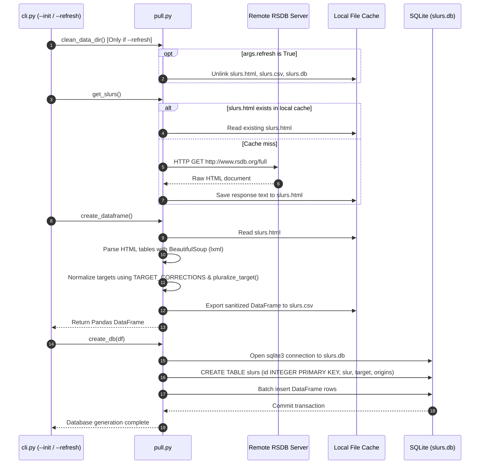

# 5.4 Data Ingestion & ETL — RSDB Web Scraper & Pluralization Normalizer

- **Source File(s)**: [`../src/slurdletwo/pull.py`](../src/slurdletwo/pull.py)
- **Architectural Role**: Extracts raw derogatory term listings and etymologies from the Racial Slur Database (RSDB), standardizes demographic target labels via automated pluralization and synonym mapping, and serializes the processed dataset into both intermediate CSV files and the production SQLite database.

## Execution Flow (`pull`)

1. **Cache Purge on Refresh**: If `--refresh` is invoked, `clean_data_dir()` unlinks existing cache and database artifacts (`slurs.html`, `slurs.csv`, `slurs.db`).
2. **HTML Retrieval & Offline Caching**: `get_slurs()` checks if `data/slurs.html` already exists locally. If present, it reuses the cached file to prevent unnecessary network load on the upstream host. On cache miss, it issues an HTTP `GET` request to `http://www.rsdb.org/full` and caches the response.
3. **DOM Parsing & Table Extraction**: `create_dataframe()` loads the HTML content into BeautifulSoup, searches for the primary data table, and parses column attributes (`Slur`, `Target`, `Origins`).
4. **Target Pluralization & Normalization**: Raw targets often mix singular and plural nouns (e.g., `"German"` vs `"Germans"`), causing fragmented demographic classes. `pluralize_target()` normalizes strings using a predefined dictionary (`TARGET_CORRECTIONS`) and heuristic pluralization rules.
5. **Relational Serialization**: The normalized DataFrame is written to `data/slurs.csv` and subsequently batch-inserted into `data/slurs.db` under the table schema `slurs`.

## Data Models, Constants, & State

| Symbol | Type / Value | Architectural Purpose |
| :----- | :----------- | :-------------------- |
| `SLURS_PATH` | `DATA_DIR / "slurs.html"` | Persistent local disk cache for raw scraped HTML. |
| `SLURS_CSV` | `DATA_DIR / "slurs.csv"` | Cleaned intermediate CSV export of parsed slur data. |
| `TARGET_CORRECTIONS` | `dict[str, str]` | Manual dictionary mapping singulars, typos, and variants to standardized plurals. |

## Symbol & Function Inventory

| Symbol | Signature & Return Type | Detailed Behavior & Side Effects |
| :----- | :---------------------- | :------------------------------- |
| `clean_data_dir` | `() -> None` | Unlinks `slurs.html`, `slurs.csv`, and `slurs.db` to prepare for a fresh scrape. |
| `get_slurs` | `() -> None` | Fetches raw HTML from RSDB if cache is absent; persists to `data/slurs.html`. |
| `pluralize_target` | `(target: str) -> str` | Transforms target strings into standardized plural representations. |
| `create_dataframe` | `() -> pd.DataFrame` | Parses HTML table with BeautifulSoup, normalizes columns, and writes `slurs.csv`. |
| `create_db` | `(df: pd.DataFrame) -> None` | Writes DataFrame records into SQLite table `slurs` using raw `sqlite3` execution. |
| `load_slurs_from_db` | `() -> pd.DataFrame` | Helper reading the `slurs` SQLite table into a Pandas DataFrame for debugging. |

## Parameter & Transformation Mapping Matrix

| Raw Input Pattern | Correction Rule | Standardized Output | Rationale |
| :---------------- | :-------------- | :------------------ | :-------- |
| `"Asian"` | `TARGET_CORRECTIONS` | `"Asians"` | Plural normalization for consistent category grouping. |
| `"Black Americans"` | `TARGET_CORRECTIONS` | `"African Americans"` | Category consolidation to canonical demographic term. |
| `"Columbian"` | `TARGET_CORRECTIONS` | `"Colombians"` | Orthographic correction of common geographical misspelling. |
| `"Scandanavians"` | `TARGET_CORRECTIONS` | `"Scandinavians"` | Orthographic typo repair. |
| Words ending in `y` | Heuristic (`ies`) | e.g. `"Gypsies"` | Standard English pluralization rule. |
| Words ending in `ch`/`sh` | Heuristic (`es`) | e.g. `"Czechs"` | Standard English pluralization rule. |

## Internal Mechanics, Error Handling, & Scraper Invariants

- **Defensive Scraping Invariant**: The scraper treats external HTML as completely untrusted. BeautifulSoup parses DOM nodes into structured strings without evaluating script tags or dynamic attributes.
- **Offline Idempotency**: By checking for `slurs.html` before dispatching HTTP network requests, the build process can be run repeatedly in offline or CI environments if the cached HTML is committed or pre-seeded.
- **Transaction Safety**: `create_db()` wraps table creation and data insertion in a single connection context, ensuring failed writes roll back cleanly.
- **Stream & Exit-Code Contract**:
  - `stdout`: Emits informational logging via `logging.StreamHandler`.
  - `stderr`: Unrecoverable network timeouts (`requests.RequestException`) or parse errors raise exceptions to the caller.
