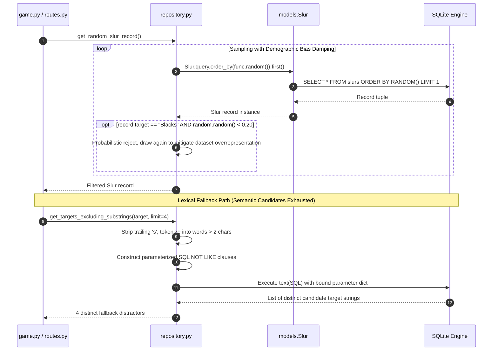

# 5.3 Data Persistence & Repository — Declarative ORM & Controlled SQL Access

- **Source File(s)**: [`../src/slurdletwo/models.py`](../src/slurdletwo/models.py), [`../src/slurdletwo/repository.py`](../src/slurdletwo/repository.py)
- **Architectural Role**: Defines the declarative database schema mapping to SQLite, encapsulates all database read operations behind parameterized queries, applies class-bias damping algorithms to normalize game presentation frequencies, and provides deterministic lexical fallback query selection.

## Execution Flow (`repository`)

1. **Random Slur Sampling**: When `get_random_slur_record()` is called, SQLAlchemy queries SQLite using `func.random()` to pull a single random record.
2. **Demographic Bias Suppression**: The scraped dataset contains an overwhelmingly disproportionate frequency of slurs targeting Black people. To prevent gameplay repetition, any record targeting `"Blacks"` is probabilistically rejected with a 20% threshold (`random.random() < 0.20`), triggering an immediate re-sample.
3. **Target Tokenization**: When `get_targets_excluding_substrings()` is invoked, the true target name is stripped of plural trailing `"s"` characters and split into individual word tokens.
4. **Parameterized Clause Generation**: For every word token longer than 2 characters, bidirectional `NOT LIKE` clauses are assembled (`target NOT LIKE :word_like_i AND :word_exact_i NOT LIKE '%' || target || '%'`) to prevent selecting root-sharing distractors (e.g., selecting `"Serbs"` when the answer is `"Serbians"`).
5. **Safe Parameter Execution**: Dynamic SQL queries are wrapped in SQLAlchemy's `text()` construct and executed against the database with bound dictionary parameters, completely preventing SQL injection.

## Data Models, Constants, & State

| Symbol | Type / Value | Architectural Purpose |
| :----- | :----------- | :-------------------- |
| `Slur` | SQLAlchemy Declarative Model | Represents a row in the `slurs` database table. |
| `Slur.id` | `Column(Integer, primary_key=True)` | Unique autoincrementing record identifier. |
| `Slur.slur` | `Column(String(255), nullable=False)` | Derogatory term string. |
| `Slur.target` | `Column(String(255), nullable=False)` | Targeted demographic or ethnic group. |
| `Slur.origins` | `Column(Text, nullable=True)` | Historical context and etymological background. |

## Symbol & Function Inventory

| Symbol | Signature & Return Type | Detailed Behavior & Side Effects |
| :----- | :---------------------- | :------------------------------- |
| `get_random_slur_record` | `() -> Slur | None` | Retrieves a random slur record from SQLite, applying 20% downsampling rejection to `"Blacks"`. |
| `get_all_unique_targets` | `() -> list[str]` | Queries and returns all distinct demographic target strings sorted alphabetically. |
| `get_targets_excluding_substrings` | `(target: str, limit: int = 4) -> list[str]` | Selects random distinct targets excluding substrings of the provided answer target. |

## Parameter & Option Mapping Matrix

| Parameter | Type / Scope | Default Value | Query / Algorithmic Effect |
| :-------- | :----------- | :------------ | :------------------------- |
| `target` | `str` (Positional) | Required | Root demographic target used to construct exclusionary `NOT LIKE` constraints. |
| `limit` | `int` (Keyword) | `4` | Maximum number of distinct distractor candidates returned by the query. |
| `record.target` | `str` (Model attribute) | Database value | Evaluated against `"Blacks"` for 20% downsampling rejection. |

## Internal Mechanics, Error Handling, & Query Invariants

- **Zero Direct Route Query Invariant**: All database access is encapsulated inside `repository.py`. Route handlers and game logic never interact directly with `db.session` or execute raw SQL strings.
- **SQL Injection Prevention**: Dynamic substring exclusion queries strictly use bound dictionary parameters (`:word_like_i`, `:word_exact_i`, `:limit`). No string formatting (`%` or f-strings) is ever evaluated directly by the SQLite engine.
- **Class Downsampling Rationale**: Without the 20% suppression loop, player sessions repeatedly feature the same demographic group, degrading educational breadth and gameplay engagement.
- **Stream & Exit-Code Contract**:
  - `stdout`: Does not write directly to console.
  - `stderr`: Unhandled SQLite connection or schema errors raise `SQLAlchemyError` or `OperationalError`.
