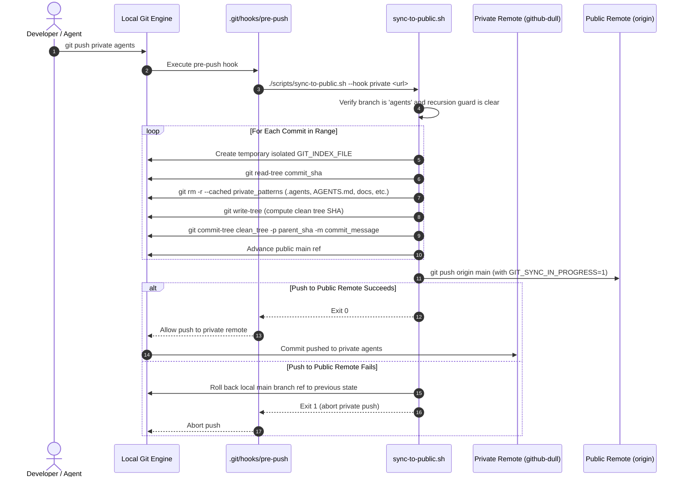

# 5.8 Repository Synchronization Automation — Dual-Branch Git Plumbing & Secret Filtering

- **Source File(s)**: [`../.agents/scripts/sync-to-public.sh`](../.agents/scripts/sync-to-public.sh)
- **Architectural Role**: Enforces strict repository isolation between the private working branch (`agents`) and the public distribution branch (`main`). Operates as a Git pre-push hook (`.git/hooks/pre-push`), leveraging low-level Git index plumbing to strip proprietary agent configurations, operational rules, and architecture manuals before replicating commits to the public remote.

## Execution Flow (`sync`)

1. **Pre-Push Interception**: Pushing branch `agents` to the private remote invokes `.git/hooks/pre-push`, passing remote target parameters to `sync-to-public.sh`.
2. **Recursion Guard**: The script inspects `GIT_SYNC_IN_PROGRESS`. If set to `1`, execution exits immediately (`exit 0`), preventing recursive sync invocations.
3. **Commit Range Traversal**: The script determines the commit range between the local branch and the remote tracking branch.
4. **Index-Level Plumbing & Exclusion**: For each commit, a temporary Git index file (`GIT_INDEX_FILE`) is instantiated. `git read-tree` loads the commit tree, and `git rm -r --cached` unlinks all patterns defined in `PRIVATE_PATTERNS` (`.agents`, `AGENTS.md`, `ARCHITECTURE.md`, `.idea`, etc.).
5. **Clean Tree Generation**: `git write-tree` computes a cryptographic SHA for the sanitized tree, and `git commit-tree` constructs a new public commit preserving the original author, committer, timestamp, and commit message.
6. **Public Replication**: The script pushes the sanitized commits to `origin main`. If the public push fails, local branch references are rolled back and the private push is aborted with exit code `1`.

## Constants, Configuration, & State

| Symbol | Type / Value | Architectural Purpose |
| :----- | :----------- | :-------------------- |
| `SOURCE_BRANCH` | `"agents"` | Private working branch containing all code, rules, and documentation. |
| `TARGET_BRANCH` | `"main"` | Public distribution branch containing sanitized, production-ready code. |
| `TARGET_REMOTE` | `"origin"` | Remote repository name targeting the public GitHub repository. |
| `PRIVATE_PATTERNS` | Array of strings | Patterns stripped from public commits (`.agents`, `AGENTS.md`, `ARCHITECTURE.md`, `.idea`). |
| `GIT_SYNC_IN_PROGRESS` | Environment Variable (`"0"` or `"1"`) | Mutex guard preventing recursive pre-push hook execution. |

## Symbol & Function Inventory

| Symbol | Scope / Context | Detailed Behavior & Side Effects |
| :----- | :-------------- | :------------------------------- |
| `log_info` | Shell Function | Prints high-level status messages with colored terminal formatting. |
| `log_step` | Shell Function | Prints granular execution steps. |
| `log_error` | Shell Function | Prints fatal error notices to `stderr`. |
| `strip_private_files` | Execution Block | Iterates over `PRIVATE_PATTERNS` and runs `git rm -r --cached --ignore-unmatch`. |

## CLI Flag & Parameter Mapping Matrix

| Parameter / Flag | Arity / Mode | Downstream Behavior |
| :--------------- | :----------- | :------------------ |
| `--dry-run` | Flag | Simulates commit tree creation and logs planned actions without updating refs or pushing. |
| `--no-push` | Flag | Replicates clean commits to the local `main` branch but skips pushing to `origin`. |
| `--hook <remote> <url>` | Positional Options | Invoked automatically by `.git/hooks/pre-push` with active push target metadata. |

## Internal Mechanics, Error Handling, & Branch Hygiene

- **Index Plumbing Isolation**: By creating a distinct `GIT_INDEX_FILE` in a temporary path, the script performs file stripping and tree calculation entirely in memory and Git object storage without touching the working tree or dirtying uncommitted local files.
- **Rollback Invariant**: If the public push fails (e.g., remote rejected non-fast-forward or network outage), the script restores the previous local `main` ref and exits with code `1`. This blocks the private push, ensuring the private and public repositories never diverge silently.
- **SSH Alias Invariant**: Private remote pushes must strictly use the custom SSH alias `github-dull` to prevent credential exposure or accidental routing to unauthorized hosts.
- **Stream & Exit-Code Contract**:
  - `stdout`: Emits step-by-step replication logs and SHA commit hashes.
  - `stderr`: Emits synchronization errors and remote rejection notices.
  - Exit Codes: `0` on successful sync or skipped pass; `1` on synchronization failure.
